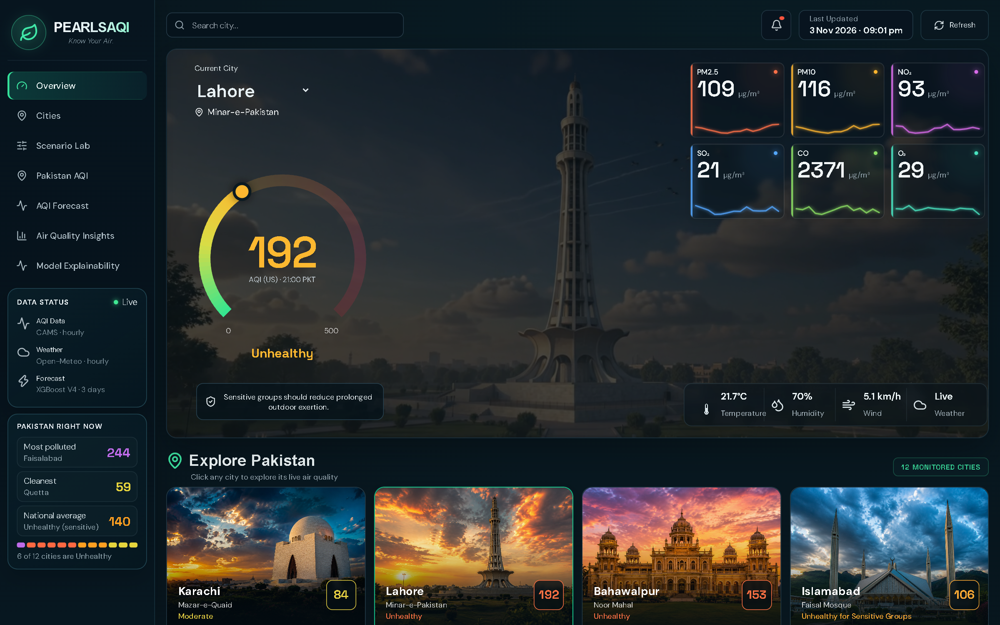
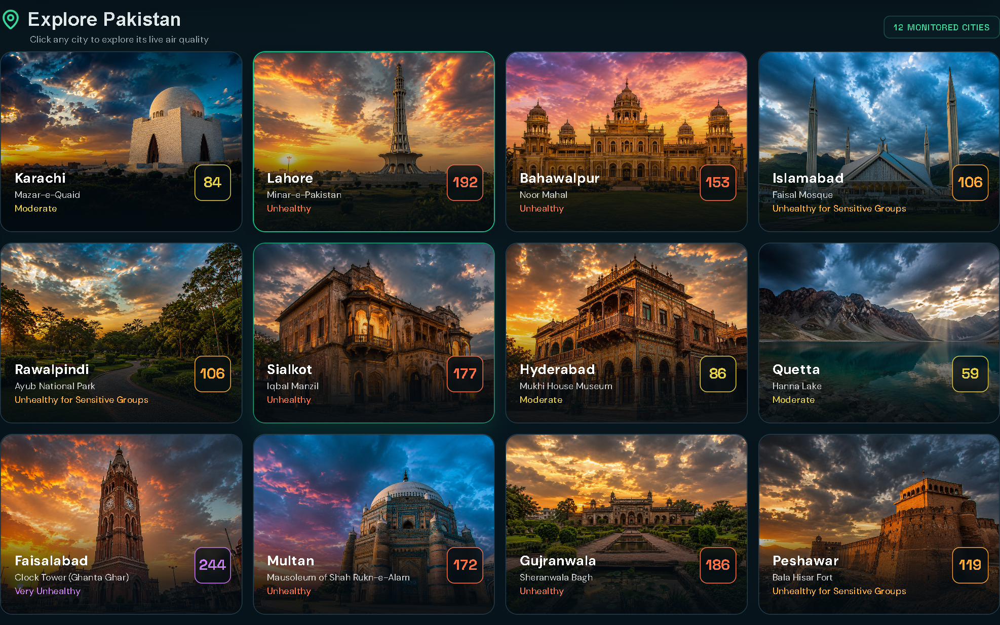
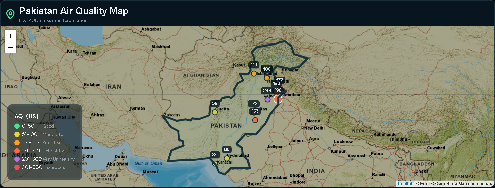
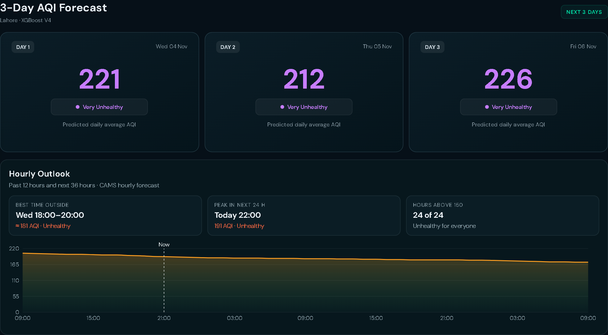
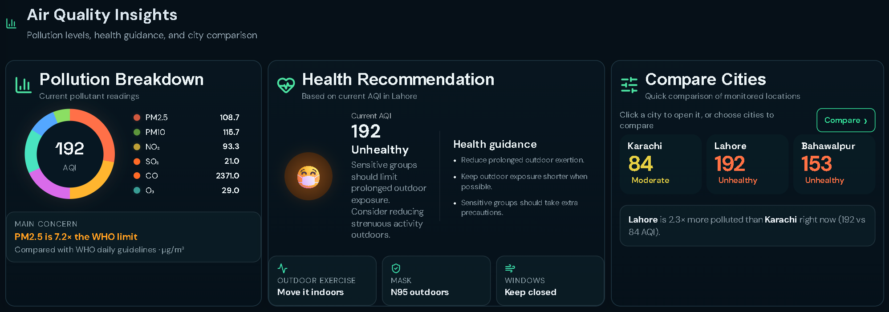
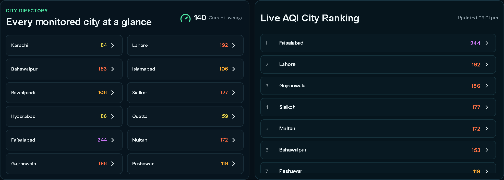
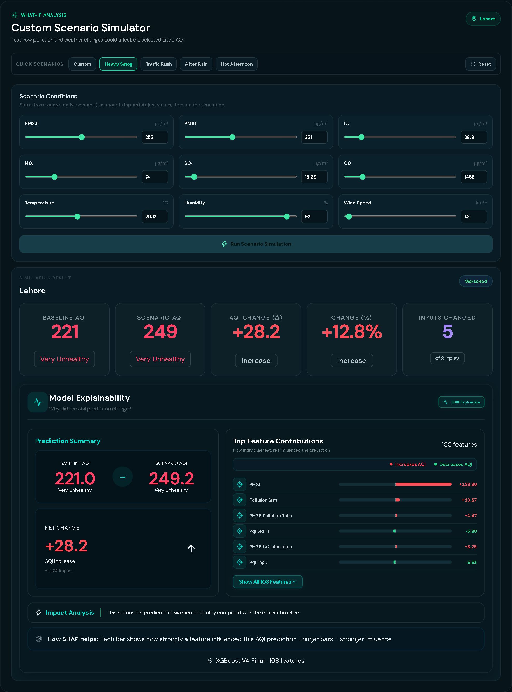
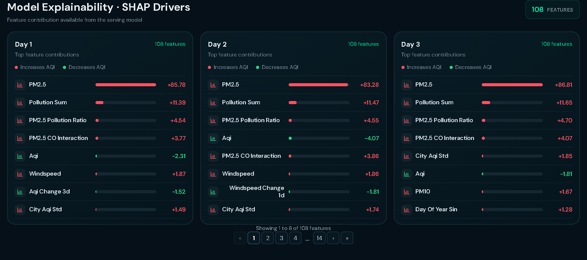
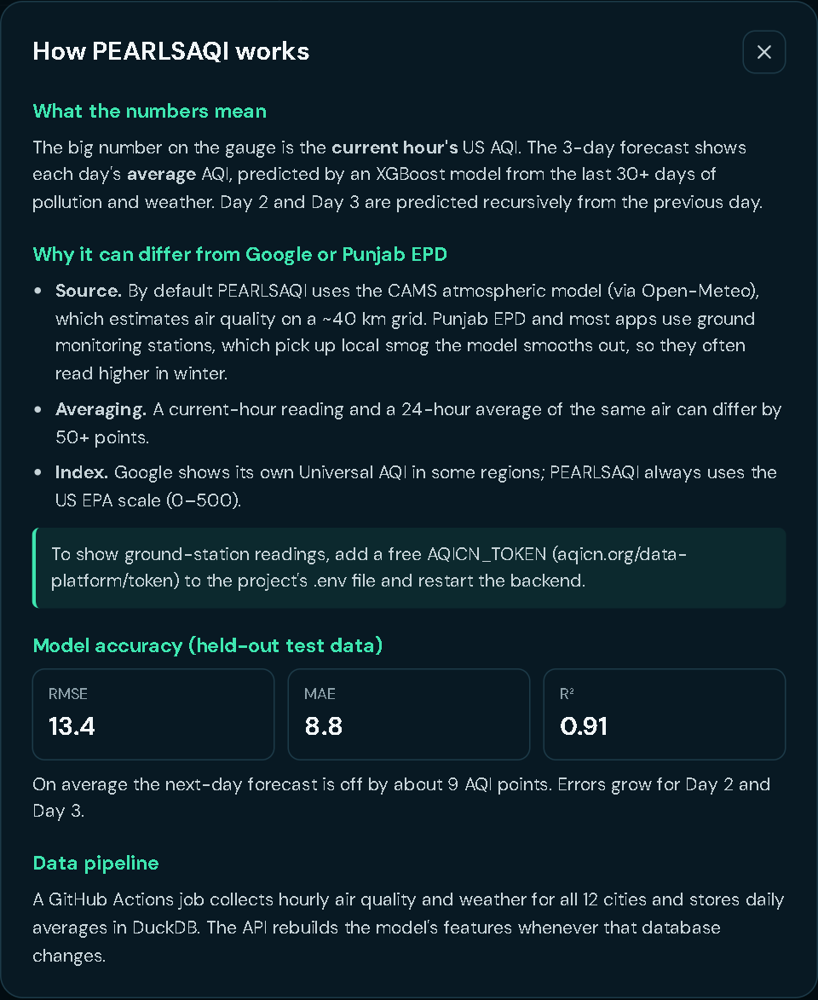
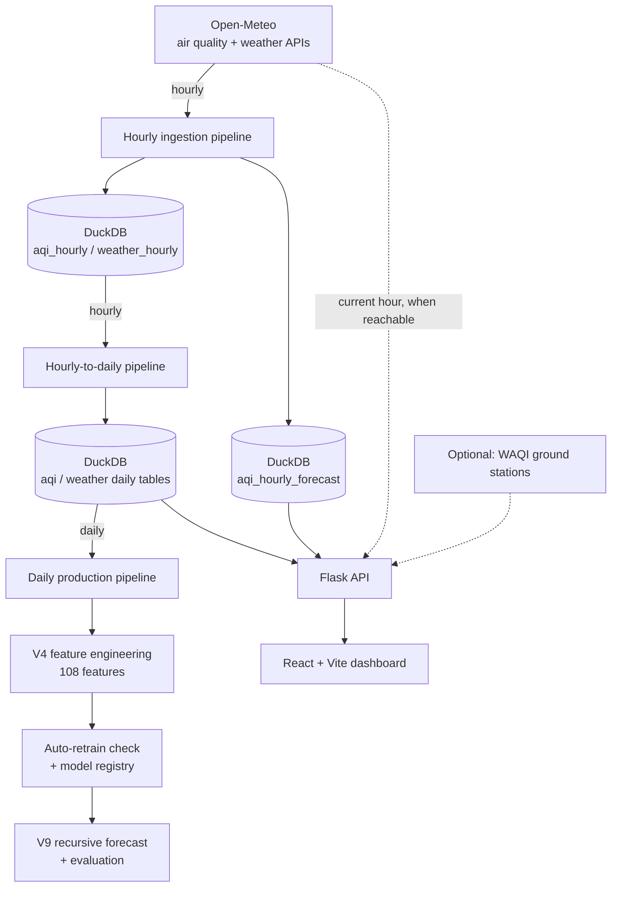

# PEARLSAQI — Pakistan AQI Prediction & Forecasting Platform

<p align="center">
  <strong>Live air quality, 3-day AQI forecasts and explainable machine learning for 12 Pakistani cities</strong>
</p>

<p align="center">
  
  
  
  
  
  
  
  <a href="LICENSE"></a>
</p>

<p align="center">
  <strong> Live dashboard: <a href="https://pearlsaqi.vercel.app">pearlsaqi.vercel.app</a></strong>
</p>

<p align="center">
  
</p>

---

## What is PEARLSAQI?

PEARLSAQI is an end-to-end air quality platform for Pakistan. It collects hourly air-quality and weather data, stores it in DuckDB, engineers 108 features, and uses an XGBoost model to forecast the next three days of AQI for each city. A Flask API serves the results to a React dashboard that explains every prediction with SHAP.

**Cities covered:** Karachi, Lahore, Islamabad, Peshawar, Rawalpindi, Faisalabad, Multan, Quetta, Hyderabad, Gujranwala, Sialkot and Bahawalpur.

### Highlights

- **Live conditions** for the current hour: US AQI, six pollutants and weather.
- **3-day recursive forecast**: each day's prediction feeds the next one.
- **Hourly outlook** for the next 36 hours, including the best time to go outside.
- **What-if simulator**: change pollutants or weather and see how the forecast responds.
- **Explainability**: SHAP contributions for all 108 features, for every forecast day.
- **Health guidance**: WHO-guideline comparison, mask, exercise and ventilation advice.
- **Automated pipelines**: GitHub Actions refreshes the data every hour and runs the full production pipeline daily.

---

## Table of Contents

- [Dashboard Tour](#dashboard-tour)
- [System Architecture](#system-architecture)
- [Data Sources & Accuracy](#data-sources--accuracy)
- [Machine Learning](#machine-learning)
- [Forecasting](#forecasting)
- [API Reference](#api-reference)
- [Automation](#automation)
- [Running Locally](#running-locally)
- [Deployment](#deployment)
- [Configuration](#configuration)
- [Project Structure](#project-structure)
- [Technology Stack](#technology-stack)
- [Limitations & Future Work](#limitations--future-work)
- [License & Data Attribution](#license--data-attribution)

---

## Dashboard Tour

### Overview

The overview shows the selected city's current-hour AQI on a gauge that runs from green (good) to red (hazardous), with the observation time underneath. Six pollutant cards plot the city's real readings for the last 14 days. The sidebar's **Pakistan right now** card shows the most polluted and cleanest city, the national average, and how many cities are currently unhealthy.

### Cities

Every monitored city with its landmark, current AQI and category. Click a card to load that city.

<p align="center">
  
</p>

### Pakistan AQI Map

Each city marker is coloured by its US EPA category and labelled with its AQI, so regional patterns such as Punjab's winter smog are visible at a glance.

<p align="center">
  
</p>

### AQI Forecast & Hourly Outlook

The model's predicted daily average AQI for the next three days, followed by an hourly chart covering the last 12 and next 36 hours of CAMS data. The hourly outlook highlights the cleanest 3-hour daytime window, the worst upcoming hour, and how many hours exceed 150.

<p align="center">
  
</p>

### Air Quality Insights

- **Pollution Breakdown:** current pollutant levels, and the pollutant furthest above its WHO daily guideline.
- **Health Recommendation:** guidance for the current AQI, plus practical advice on outdoor exercise, masks and windows.
- **Compare Cities:** a side-by-side comparison of any cities you choose.

<p align="center">
  
</p>

A city directory and a live ranking of all 12 cities follow; click any row to open that city.

<p align="center">
  
</p>

### Scenario Simulator

Start from the exact daily values the model used, adjust any of the nine inputs (or pick a preset such as *Heavy Smog* or *After Rain*), and run the model. The result shows the baseline vs scenario AQI, the change, which inputs you changed, a 3-day scenario forecast, and the SHAP features that drove the difference.

<p align="center">
  
</p>

### Model Explainability

SHAP contributions for each of the three forecast days, paged through all 108 features. Red bars push the prediction up, green bars pull it down.

<p align="center">
  
</p>

### How it works

**Learn More** in the footer opens an explanation of what the numbers mean, why they can differ from official sources, and the model's measured accuracy.

<p align="center">
  
</p>

🎥 A recording of an earlier version of the dashboard is in [`docs/screenshots/Project Demo.mp4`](docs/screenshots/Project%20Demo.mp4).

---

## System Architecture



The Flask API builds its model features directly from the daily tables in `database/aqi.duckdb`, using the same feature code as training, and rebuilds them whenever the database file changes. The dashboard is therefore always as fresh as the database the hourly pipeline maintains.

For the current hour and the hourly outlook, the API asks Open-Meteo first. If Open-Meteo can't be reached (it rate-limits shared cloud hosts such as Render's free plan), it uses the latest stored hour and the forecast the hourly pipeline saved in `aqi_hourly_forecast`. Every outside call has a 20-second limit, so a slow service never blocks the dashboard.

---

## Data Sources & Accuracy

| Source | Used for | Key needed |
|---|---|---|
| [Open-Meteo Air Quality API](https://open-meteo.com/en/docs/air-quality-api) (CAMS model) | Hourly US AQI and pollutants (PM2.5, PM10, NO₂, SO₂, CO, O₃), history and 4-day forecast | No |
| [Open-Meteo Weather APIs](https://open-meteo.com/) | Temperature, humidity, precipitation, wind: history, current and forecast | No |
| [World Air Quality Index (WAQI)](https://aqicn.org/data-platform/token/) | Optional ground-station readings for the live gauge | Free token |

### Why the numbers can differ from Google or Punjab EPD

- **Model vs stations.** CAMS estimates air quality on a ~40 km grid. Ground monitors used by Punjab EPD and most apps pick up local smog that the grid smooths out, so they often read higher in winter. Set `AQICN_TOKEN` (see [Configuration](#configuration)) to show the nearest station's reading on the gauge. Stations more than 40 km from a city are ignored.
- **Averaging window.** The gauge shows the current hour; forecasts are daily averages. The two can differ by 50+ points on the same day.
- **Index.** PEARLSAQI always uses the US EPA AQI scale (0–500).

The forecasting model is trained on CAMS data, so forecasts stay on that scale even when the gauge shows a station reading.

---

## Machine Learning

### Model

The served model is **XGBoost V4 Final 108**, an `XGBRegressor` that predicts the next day's average AQI from 108 engineered features:

| Family | Examples |
|---|---|
| AQI history | lags (1–14 days), changes, acceleration, rolling mean/std/min/max, trends, percentiles |
| Pollutants | levels, 1- and 3-day changes, rolling means, trends |
| Interactions | PM2.5/PM10 ratio, PM2.5 × NO₂/CO/O₃, pollution sum, `pm25_pollution_ratio` |
| Weather | temperature, humidity, precipitation, wind and their changes |
| Regimes | AQI category flags, regime changes, recent extreme days |
| City history | expanding city mean/std, 30-day recent mean and max |
| Calendar | month and day-of-year (sin/cos), weekday, weekend |

### Accuracy (held-out test data)

| Metric | Result |
|---|---:|
| RMSE | 13.37 AQI |
| MAE | 8.80 AQI |
| R² | 0.913 |

These measure next-day (Day 1) error. Day 2 and Day 3 are produced recursively, so their error is larger.

### Explainability

SHAP `TreeExplainer` explains every forecast day and every scenario run. LIME and offline SHAP analysis scripts live in `src/explainability/`.

---

## Forecasting

Forecasts are **recursive**: each day's prediction becomes the next day's AQI history.

```text
features(D)                        → AQI(D+1)   Day 1
features(D+1, AQI = Day 1 result)  → AQI(D+2)   Day 2
features(D+2, AQI = Day 2 result)  → AQI(D+3)   Day 3
```

For each future day, pollutants are held at the latest observed values, and weather comes from the observed `weather` table or the stored `weather_forecasts`. Expanding city statistics are recalculated over the full history, so the recursive features match the training features.

The daily pipeline also runs the V9 forecast engine (`src/ml/forecast_engine_v9.py`), which applies calibration and stores 36 forecasts per day (12 cities × 3 days) in `forecast_predictions`. Those forecasts are later compared with actual AQI for monitoring.

---

## API Reference

The Flask backend (`app.py`) runs on `http://localhost:5000`.

| Method | Endpoint | Returns |
|---|---|---|
| GET | `/health` | Model and data status, including where live data came from and the last live-data error |
| GET | `/api/predict/<city>` | Current conditions and their source, pollutants, 3-day forecast with SHAP per day, model metrics, and the exact model inputs |
| GET | `/api/hourly/<city>` | Hourly US AQI and PM2.5, past 12 h and next 36 h, with its `source` |
| GET | `/api/trends/<city>` | Full daily AQI and pollutant history |
| POST | `/api/scenario-predict` | What-if prediction. Body: `{"city": "Lahore", "scenario": {"pm25": 200, "wind_speed": 3}}` |
| GET | `/api/model-stats` | All models in the local model registry |

Example:

```bash
curl http://localhost:5000/api/predict/Lahore
```

---

## Automation

Two GitHub Actions workflows keep the data current. Both commit the updated `database/aqi.duckdb` back to `main`.

| Workflow | Schedule | Does |
|---|---|---|
| **Hourly AQI Data Pipeline** | every hour at :17 | Downloads the latest hourly US AQI and weather for all 12 cities, saves the next ~70 forecast hours to `aqi_hourly_forecast`, rebuilds the daily tables, validates coverage |
| **Daily AQI Production Pipeline** | 02:30 UTC | AQI and weather catch-up, future weather forecast, V4 feature engineering, dataset split, auto-retrain check (the production model is replaced only if a candidate is better), V9 forecast, forecast evaluation |

GitHub runs scheduled workflows on a best-effort basis and often delays them on free repositories, so "hourly" runs can be a few hours apart. The dashboard labels the hour its reading comes from.

Downloads are retried up to four times; if a city still fails, the run fails so the workflow's own retry loop runs again.

### Repairing older hourly data

The hourly workflow normally re-downloads the last 2 days. To re-download up to 92 days (for example after a data-source fix), open **Actions → Hourly AQI Data Pipeline → Run workflow** and set **past_days** to `92`. Locally, the same repair is:

```powershell
$env:HOURLY_PAST_DAYS = 92
python -m src.pipelines.hourly_ingestion_pipeline
python -m src.pipelines.hourly_to_daily_pipeline
```

---

## Running Locally

**Requirements:** Python 3.11+ and Node.js 20+.

### 1. Clone and install

```bash
git clone https://github.com/VrdaRehman01/PEARLSAQI.git
cd PEARLSAQI

python -m venv .venv
# Windows
.venv\Scripts\activate
# Linux / macOS
source .venv/bin/activate

pip install -r requirements.txt

cd frontend
npm ci
cd ..
```

### 2. Start the backend (terminal 1)

```bash
python app.py
```

Wait for `Running on http://127.0.0.1:5000`. The first start takes about 20 seconds while features are built from the database.

### 3. Start the frontend (terminal 2)

```bash
cd frontend
npm run dev
```

Open **http://127.0.0.1:5173**. The Vite dev server forwards `/api` requests to the backend.

### Production build

```bash
cd frontend
npm run build
```

`python app.py` then serves the built dashboard from `frontend/dist` at http://127.0.0.1:5000.

---

## Deployment

The dashboard is deployed as two services:

| Part | Host | Config |
|---|---|---|
| Flask API | [Render](https://render.com) (free web service) | `render.yaml`, `requirements-api.txt` |
| React dashboard | [Vercel](https://vercel.com) | `frontend/vercel.json` |

Vercel forwards every `/api/*` request to the Render API, so the dashboard code is the same locally and in production.

### 1. API on Render

1. In Render, choose **New → Blueprint** and select this repository. Render reads `render.yaml` and creates the `pearlsaqi-api` web service.
2. Optionally set `AQICN_TOKEN` under the service's **Environment** tab.
3. Wait for the first deploy, then open `https://pearlsaqi-api.onrender.com/health`. It should return `"status": "ok"`.

The API installs only `requirements-api.txt` (no TensorFlow or Jupyter) and peaks around 350 MB of memory, inside the free plan's 512 MB. It downloads the latest `database/aqi.duckdb` from GitHub every 30 minutes (`REMOTE_DATABASE_URL`), so the hourly database commits don't need redeploys; `render.yaml` tells Render to ignore them.

> The free plan sleeps after 15 minutes without traffic. The first request after that takes about a minute while the service wakes up and builds its features.

### 2. Dashboard on Vercel

1. In Vercel, choose **Add New → Project** and import this repository.
2. Set **Root Directory** to `frontend` and keep the **Vite** preset, then **Deploy**. `frontend/vercel.json` builds the app and forwards `/api/*` to Render.

If Render gives the service a different address than `pearlsaqi-api.onrender.com`, update the `destination` in `frontend/vercel.json`.

### Docker

The `Dockerfile` runs the API the same way Render does (gunicorn, `requirements-api.txt`):

```bash
docker compose up --build
```

The API is then available at http://localhost:5000/health. `docker-compose.yml` keeps the database current from GitHub and passes `AQICN_TOKEN` from your `.env`.

---

## Configuration

Copy `.env.example` to `.env` in the project root:

| Variable | Default | Purpose |
|---|---|---|
| `AQICN_TOKEN` | *(empty)* | Optional [WAQI token](https://aqicn.org/data-platform/token/). When set, the live gauge shows the nearest ground station within 40 km. |
| `PORT` | `5000` | Port for the Flask backend |
| `HOURLY_PAST_DAYS` | `2` | Days of hourly history the hourly pipeline re-downloads (max 92) |
| `REMOTE_DATABASE_URL` | *(empty)* | Deployment only: URL of `database/aqi.duckdb` to download and refresh |
| `DATABASE_REFRESH_SECONDS` | `1800` | How often the API checks `REMOTE_DATABASE_URL` for a newer database |

---

## Project Structure

```text
PEARLSAQI/
├── app.py                         # Flask API + serves the built dashboard
├── train_models.py                # trains the registry's ridge, XGBoost and deep-learning models
├── frontend/                      # React + Vite dashboard
│   ├── src/App.jsx
│   ├── public/landmarks/          # city photos and videos
│   ├── public/pakistan.geojson    # map outline
│   └── vercel.json                # Vercel build + /api forwarding
├── src/
│   ├── pipelines/                 # hourly, hourly→daily and daily production pipelines
│   ├── ingestion/                 # Open-Meteo downloaders
│   ├── services/                  # weather history and forecast services
│   ├── features/                  # V4 feature engineering
│   ├── ml/                        # training, forecast engine V9, calibration, research
│   ├── models/                    # local model registry
│   ├── explainability/            # SHAP and LIME
│   ├── database/                  # DuckDB connection, schema, repositories
│   └── alerts/                    # AQI alert levels
├── models/
│   ├── benchmark/v4/final_candidate/   # served XGBoost V4 model
│   ├── registry/                  # versioned models + registry.json
│   └── forecast/calibration_v9/   # forecast calibration parameters
├── database/aqi.duckdb            # main database, updated by GitHub Actions
├── scripts/
│   ├── data/                      # historical data download
│   ├── evaluation/                # forecast evaluation, model drift monitor
│   └── maintenance/               # database table setup and cleanup
├── notebooks/eda.ipynb            # exploratory data analysis
├── docs/
│   ├── PEARLSAQI-Report.pdf       # project report
│   └── screenshots/               # README images and demo video
├── .github/workflows/             # hourly and daily pipelines
├── requirements.txt               # full stack: pipelines, training, notebooks
├── requirements-api.txt           # API only (Render and Docker)
├── render.yaml                    # Render deployment
├── Dockerfile, docker-compose.yml # API container
└── .env.example
```

---

## Technology Stack

| Layer | Technology |
|---|---|
| Machine learning | XGBoost, scikit-learn, TensorFlow (deep-learning baselines) |
| Explainability | SHAP, LIME |
| Data | pandas, NumPy, PyArrow, DuckDB |
| Backend | Flask, Flask-CORS |
| Frontend | React 19, Vite, Recharts, React Leaflet, Lucide |
| Data sources | Open-Meteo (CAMS), optional WAQI |
| Automation | GitHub Actions |
| Containers | Docker, Docker Compose |

---

## Limitations & Future Work

- **Model-based data.** Default readings come from the CAMS model, not ground stations, and can underestimate local smog. Station readings are optional and shown only on the live gauge.
- **Held pollutants.** Recursive forecasts hold pollutants at today's levels. Using CAMS pollutant forecasts as inputs could improve Day 2 and Day 3.
- **Single model for all horizons.** Dedicated 48 h and 72 h models may reduce long-horizon error.
- **Free hosting.** Render's free plan sleeps after 15 idle minutes (the first visit then takes about a minute), and Open-Meteo rate-limits it, so the live site shows the latest stored hour rather than the current one.
- **Coverage.** 12 cities; the pipeline is designed to add more.

---

## License & Data Attribution

The code in this repository is released under the [MIT License](LICENSE). © 2026 Warda Rehman.

The data it uses comes from third parties, under their own terms:

- **Air quality and weather:** [Open-Meteo](https://open-meteo.com/), licensed under [CC BY 4.0](https://creativecommons.org/licenses/by/4.0/). Air-quality data is based on the [Copernicus Atmosphere Monitoring Service (CAMS)](https://atmosphere.copernicus.eu/).
- **Ground-station readings (optional):** [World Air Quality Index Project](https://aqicn.org/), under its [terms of use](https://aqicn.org/api/tos/).
- **Map tiles:** © [Esri](https://www.esri.com/) and © [OpenStreetMap](https://www.openstreetmap.org/copyright) contributors, displayed with [Leaflet](https://leafletjs.com/).

AQI values and forecasts are model estimates for information only, not official health advice. For official readings, consult the Punjab Environmental Protection Department or your local authority.

---

<p align="center">Built for cleaner air in Pakistan 🇵🇰</p>
